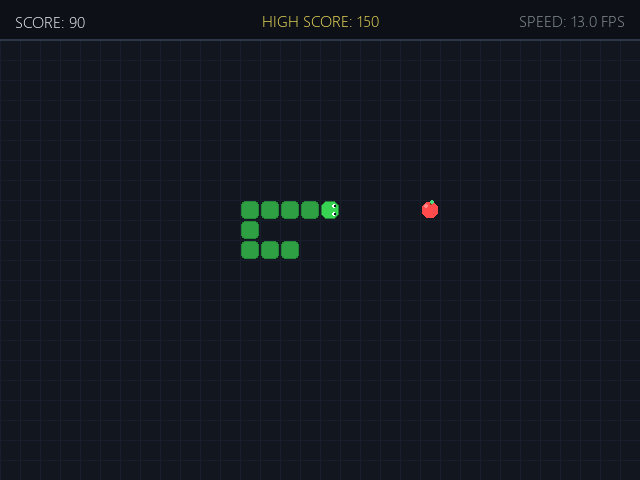

# 🐍 Snake Game

A modern, polished, and responsive implementation of the classic retro arcade **Snake Game** built in Python with **Pygame**.


---

## 🎮 Gameplay Preview



---

## ✨ Features

- **Classic Gameplay Preserved**: Faithful to the original arcade mechanics with smooth grid-based movement.
- **Modern Dark UI**: Sleek, clean visual design with subtle grid lines, stylized snake head with animated eyes, and glowing fruits.
- **Top Status HUD**: Displays live **Score**, persistent **High Score**, and dynamic **Speed (FPS)**.
- **Intelligent Fruit Spawning**: Prevents fruit from ever spawning inside the snake's body.
- **Adaptive Difficulty Scaling**: Snake speed increases dynamically as your score climbs, providing an engaging challenge.
- **Complete Game States**:
  - **Start Screen** with game guide and high score.
  - **Pause Menu** (`P` or `Space`) to pause and resume on demand.
  - **Game Over Screen** with final score breakdown, new high score notifications, and instant restart (`R` or `Space`).
- **Flexible Controls**: Full support for both standard **Arrow Keys** and **WASD**.
- **Accidental Reversal Protection**: Prevents 180-degree instant turns that would cause immediate self-collision.
- **Cross-Platform Compatibility**: Fully tested and optimized for **Windows 10/11**, **macOS**, and **Linux**.

---

## 🕹️ Controls

| Action | Primary Key | Alternative Key |
| :--- | :--- | :--- |
| **Move Up** | `↑` (Up Arrow) | `W` |
| **Move Down** | `↓` (Down Arrow) | `S` |
| **Move Left** | `←` (Left Arrow) | `A` |
| **Move Right** | `→` (Right Arrow) | `D` |
| **Start Game** | `Space` | `Enter` |
| **Pause / Resume** | `P` | `Space` |
| **Restart Game** | `R` | `Space` / `Enter` |
| **Quit Game** | `Esc` | `Q` |

---

## 📁 Project Structure

```text
Snake-Game/
├── snake.py                  # Main game executable script
├── requirements.txt          # Python project dependencies
├── README.md                 # Detailed documentation & setup guide
├── .gitignore                # Git ignore configuration
└── screenshots/
    └── game_screenshot.png   # Gameplay preview image
```

---

## 🚀 Installation & Setup

### 1. Prerequisites
Ensure you have **Python 3.8** or newer installed on your machine.
Verify your Python installation:

```bash
python --version
```

### 2. Clone the Repository
Clone the project repository to your local machine:

```bash
git clone https://github.com/sandhiyabalasubramani/Snake-Game.git
cd Snake-Game
```

### 3. (Optional) Create a Virtual Environment
It is recommended to run the project in an isolated virtual environment:

**On Windows:**
```powershell
python -m venv venv
.\venv\Scripts\activate
```

**On macOS / Linux:**
```bash
python3 -m venv venv
source venv/bin/activate
```

### 4. Install Dependencies
Install all required packages via `requirements.txt`:

```bash
pip install -r requirements.txt
```

---

## 🎯 How to Run the Game

Execute the main game script using Python:

```bash
python snake.py
```

### Headless / Screenshot Generation Mode
To verify the game engine or capture an updated preview screenshot:

```bash
python snake.py --screenshot
```

---

## 🏆 Scoring & Difficulty Progression

- **Base Score**: Each piece of fruit eaten rewards **+10 points**.
- **Speed Curve**: The snake begins at a relaxed **10 FPS** and increases by **+1 FPS** for every 30 points scored, capping at **24 FPS** for an exhilarating high-level challenge.
- **High Score**: Your personal best score is automatically saved locally in `highscore.txt` and preserved across sessions.

---

## 🛠️ Troubleshooting (Windows)

- **Pygame Audio / Window Issues**: Ensure you have installed the official Pygame wheel via `pip install pygame`.
- **Command Not Found**: If `python` is not recognized in your command prompt, check the "Add Python to PATH" option in your Python installer or run using `py snake.py`.

---

## 📄 License

This project is licensed under the [MIT License](LICENSE) - open for learning, modification, and sharing.

